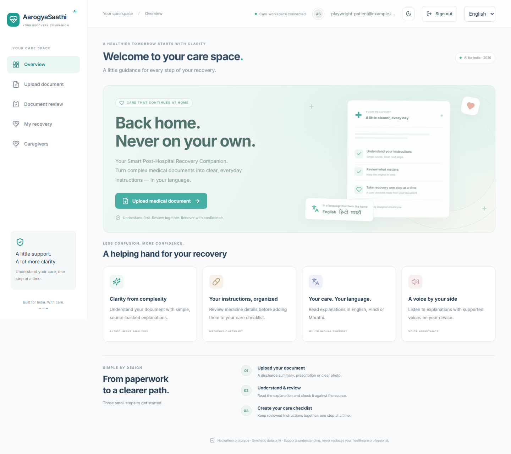
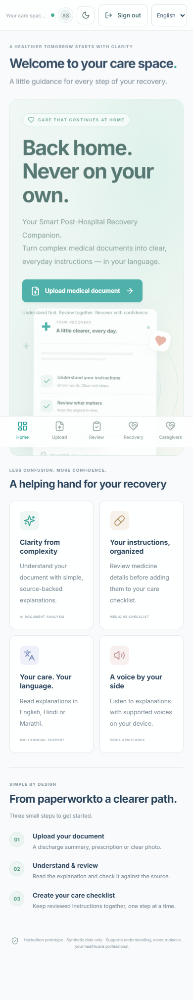
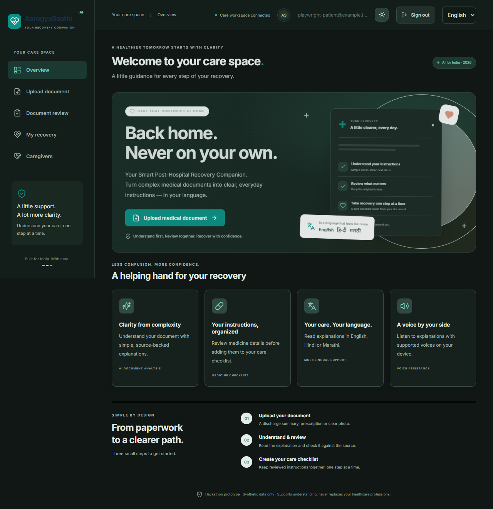

# AarogyaSaathi AI

**A local, mobile-friendly recovery companion for understanding discharge instructions.** The hackathon prototype combines OCR and Gemini document analysis, keeps the original beside extracted instructions, asks the patient to review each item, and turns approved items into a saved recovery checklist.

> **Prototype only:** use fictional documents. This project is not clinically validated or ready for real patient records. AI and OCR can be wrong; compare results with the original and ask a healthcare professional about unclear instructions.



## Current project status

The local MVP is implemented and its core flows pass automated backend and browser checks. The repository includes a prioritized checklist in [PROJECT_STATUS.md](PROJECT_STATUS.md), a [demo walkthrough](DEMO_GUIDE.md), and a [production-readiness plan](docs/PRODUCTION_READINESS.md).

**Implemented:** printed and handwritten document paths; PDF, PNG and JPEG upload; PyMuPDF and Tesseract OCR; Gemini text and image analysis; source evidence and uncertainty handling; patient review; persistent categorized recovery tasks; English, Hindi and Marathi explanation and voice fallback; document-grounded chat with source quotations; Indian CDSCO medicine-use lookup and NPPA price-check links; patient accounts; patient-controlled caregiver invitations and revocation; access/task audit events; explicit-date reminder states; responsive layouts; persistent light/dark theme.

**Latest checked status (16 October 2026):** 61 backend tests pass; 13 Playwright browser tests pass and 2 opt-in live-provider tests are skipped; the Vite production build passes. The checked-in automated suite uses synthetic fixtures and an isolated browser-test database. See [PROJECT_STATUS.md](PROJECT_STATUS.md) for coverage and remaining work.

### Priority status

| Priority | Status | Scope |
| --- | --- | --- |
| P0 · Core prototype | Complete | Upload, extraction, grounded analysis, review gate, saved recovery checklist, medicine information |
| P1 · Hackathon expansion | Complete for local prototype | Document Q&A, caregiver consent and permissions, categorized tasks, date-aware reminder states, localization, dark mode |
| P2 · Before real-world pilot | Pending | Clinical and privacy review, identity assurance, MFA/account recovery, encrypted managed storage, deletion/retention, hardened deployment |
| Later product work | Pending | Recurring/push reminders, broader language/OCR evaluation, React Native/Expo client, integrations after review |

## Features

- **Hybrid OCR:** embedded PDF text when readable; Tesseract for scans and images; mixed PDFs are routed page by page. Handwritten mode sends the original image to Gemini Vision for constrained transcription. Handwritten medicine details always require professional verification.
- **Evidence-led review:** extracted items include source wording and uncertainty flags. Incomplete or uncertain items cannot be marked Patient Reviewed. Missing medicine times are never guessed.
- **Recovery checklist:** reviewed instructions are stored locally with completion state, task categories, and explicit date/time status. These are one-time on-screen reminders, not alarms or push notifications.
- **Medicine information:** CDSCO approved-use lookup is presented as general approved indications, not the prescriber's reason. Current price checking links to NPPA Pharma Sahi Daam; the app does not invent an exact rupee price.
- **Ask AarogyaSaathi:** document-grounded questions, saved per-document history, quotations checked against extracted source text, and refusal when support is missing.
- **Regional access:** English, Hindi and Marathi explanations; Gemini TTS can provide Hindi/Marathi speech when a matching device voice is unavailable, subject to internet access and provider quota.
- **Accounts and caregivers:** local account sessions isolate patient records. Patients initiate one-time caregiver invitations, choose task-completion permission, and can revoke access. Codes must be shared manually; the app does not send email.
- **Interface:** responsive phone/desktop layouts, camera input, reduced-motion support, and a light/dark toggle whose preference is saved in the browser.
- **Synthetic fixtures:** fictional documents and prerecorded results support repeatable checks. They are not shown as user-facing demo prescriptions.

## Architecture

React 19 + Vite + React Router + Tailwind + Lucide → FastAPI → PyMuPDF/Tesseract → Google GenAI → Pydantic/source checks → patient review → SQLAlchemy/SQLite.

```text
frontend/src/       React interface and API client
frontend/tests/     Playwright browser flows
backend/app/        FastAPI routes, models and analysis/OCR services
backend/tests/      Isolated pytest workflow tests
demo/               Fictional documents and prerecorded test fixtures
docs/               Hybrid OCR brief and production-readiness gates
scripts/            Windows startup, sample generation and OCR/Gemini checks
screenshots/        Desktop, mobile and dark-mode captures
```

## Run locally on Windows

Requirements: Python 3.11+, Node 20.19+ (or 22.12+), and Tesseract OCR. Install Tesseract (English OCR) if it is not already available, then from the project root:

```powershell
python -m venv backend/.venv
.\backend\.venv\Scripts\python -m pip install -r backend/requirements.txt
cd frontend
npm ci
cd ..
Copy-Item backend/.env.example backend/.env
```

Keep credentials in the ignored `backend/.env`. Add a Google AI Studio key there for live analysis, and confirm the project uses the Free plan before setting `FREE_TIER_CONFIRMED=true`. The app does not enable billing, switch models, or use a paid fallback. If you want prerecorded/offline analysis, set `DEMO_MODE=true`. Restart the backend after changing `.env`.

Run the services in separate terminals from the project root:

```powershell
.\backend\.venv\Scripts\python -m uvicorn app.main:app --app-dir backend --host 127.0.0.1 --port 8000
```

```powershell
cd frontend
npm run dev
```

Open [http://localhost:5173](http://localhost:5173). Alternatively, `powershell -ExecutionPolicy Bypass -File scripts/start.ps1` starts both services in hidden windows and prints their process IDs.

Create an account with email and a password of at least 12 characters. The caregiver invitation code is optional. Existing unowned local records are assigned to the first account; later accounts only see their own records unless a patient shares access. Keep the app on localhost and use synthetic files.

## Test

```powershell
cd backend
.\.venv\Scripts\python -m pytest -q
cd ../frontend
npm run build
npm run test:e2e
```

The browser suite needs Google Chrome (or change `channel` in `frontend/playwright.config.js` to `msedge`). Backend tests use temporary databases; Playwright uses its own isolated test database. Live Gemini tests are opt-in and consume provider quota; see the test files and [DEMO_GUIDE.md](DEMO_GUIDE.md).

## Safety and remaining work

- This is not a diagnostic or prescribing tool. Patient Reviewed records a text check; it does not mean clinically verified.
- Use fictional documents only. The local SQLite database and uploads are not encrypted at rest. Local account isolation and caregiver access controls are prototype foundations, not production identity assurance or formal privacy compliance.
- Live printed analysis sends extracted text to Google; handwritten analysis sends the original image and then its transcription for structured analysis. Review provider terms and data handling before any real-world use.
- No email verification, MFA, account recovery, encrypted managed storage, retention/deletion workflow, clinical validation, security/privacy approval, or public deployment is implemented.
- Hindi/Marathi TTS needs an internet connection and available Google quota when the device has no matching voice. Physical speaker output depends on the device.
- OCR/transcription accuracy is not established by the small synthetic test set. Do not use real prescriptions as test fixtures.

For the complete remaining-work list and release gates, see [PROJECT_STATUS.md](PROJECT_STATUS.md) and [docs/PRODUCTION_READINESS.md](docs/PRODUCTION_READINESS.md).

## Screenshots

| Desktop | Mobile | Dark mode |
| --- | --- | --- |
|  |  |  |
